# Процессор

## Элементы процессора
- Дешифратор команд
- Операционные устройства (Арифметико-логическое устройство (АЛУ))
- Устройство управления 
- Регистры
- Транслятор адресов операндов
- Шины

## Операционные устройства

Операционные устройства:
- целочисленной арифметики
- логических операций
- операций сдвига
- десятичной арифметики
- чисел с плавающей запятой
- графических операций ...

Структурный базис - набор элементов, на основе которых строятся структуры операционных устройств. 
- регистры - обеспечивают хранение слов данных;
- шины - связывают регистры и предназначены для передачи слов данных;
- комбинационные схемы - реализуют вычисления по управляющим сигналам от устройства управления.

## Операционные устройства. Регистры

Регистр - линейка триггеров, имеющих входы для изменения состояния, которое влияет на выходы. Регистры могут быть:
- программно-видимые явно
- видимые косвенно,  такие как "теневые" регистры дескрипторов сегментов
- внутренние для специальных целей, например регистр адреса памяти и регистр данных для обмена с памятью
- внутренние для хранения внутренних промежуточных результатов

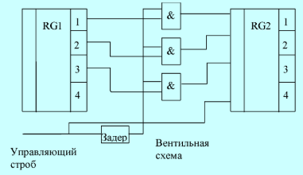

## Простейший мультиплексор

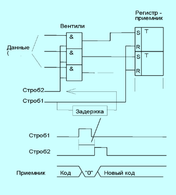

## Операционные устройства. АЛУ

АЛУ - комбинационная схема, (т.е. она не содержит внутри элементов памяти), принимающая на два входа два операнда и формирующая на выходе результат операции.

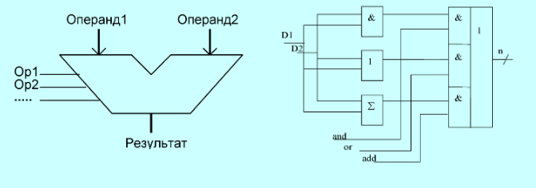

Состав АЛУ:
- Логическое устройство
- Полный сумматор
- Декодер операции

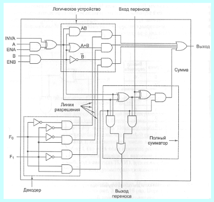

Восьмизарядгный АЛУ состоит из 8 1-битовых АЛУ.

## Простейшие операционные устройства
**Пересылка (mov R1,R2)**

Данные из регистра R1 через логический элемент «И» (управляемый сигналом T1) передаются в регистр R2

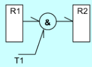

**Сдвиг rol R0**

Сигнал T2 пропускает биты через сдвигатель, а T3 замыкает обратную связь (старший бит переходит в младший).

Ниже представленна схема циклического сдвига влево на 1 бит.

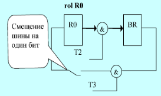

**Сложение add R0, R1**

Данные из R0 и R1 поступают в регистры RA и RB (по сигналам T4, T5).
АЛУ выполняет операцию (выбор задается сигналами add/sub/or).
Результат сохраняется в регистре RC и по сигналам T8 или T9 записывается обратно в R0 или BR.

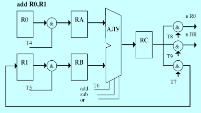

## Операционное устройство с магистральной структурой
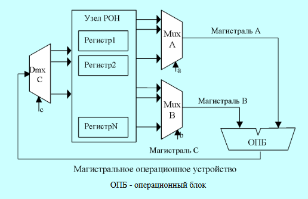

Типы операционных устройств с магистральной структурой:

**Трехмагистральное ОПУ**

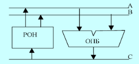

**Двухмагистральное ОПУ**

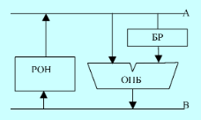

**Одномагистральное ОПУ**

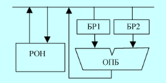

## Функции устройства управления
- Формирует необходимые управляющие сигналы для выборки очередной команды из ОЗУ,
- Дешифрации кода операции,
- Формирование адресов операндов,
- Выборки операндов из ОЗУ,
- Передача операндов в операционное устройство,
- Выполнение операций операционным устройством,
- Передача результата из операционного устройства в ОЗУ, 
- Инициирование операции ввода/вывода, 
- Организация реакции процессора на запросы прерывания.

## Устройство управления. Микропрограммный автомат
- Микрооперация - элементарные действия, выполняемые в течение одного такта сигналов синхронизации.
- Микрокоманда - совокупность одновременно выполняемых микроопераций.  
- Микропрограмма - последовательность микрокоманд, определяющая порядок реализации машинного цикла. 

## Состав устройства управления 
Состав управляющей части УУ: 
- регистр команды, 
- микропрограммный автомат (+ дешифратор команд), 
- узел прерываний и приоритетов. 

Состав адресной части УУ:
- операционный узел устройства управления, 
- регистр адреса, 
- счетчик команд. 

## Микропрограммный автомат с жесткой логикой
- Выходные сигналы управления реализуются за счет однажды соединенных логических схем.
- Код операций (КОП), определяет какие сигналы управления и в какой последовательности должны формироваться. 
- Сигналы управления, по которым выполняется микрооперация, вырабатываются в строго определенные моменты времени, “привязаны” к импульсам синхронизации.
- Счетчик тактов сбрасывается по окончании цикла очередной команды. 
- Цикл команды может потребовать разного количества тактов. На каждом такте вырабатывается своя микрокоманда, состоящая из нескольких сигналов управления. 
- Дополнительным фактором, влияющим на выработку сигналов управления, являются флаги.

Схема микропрограммного автомата с жесткой логикой: 

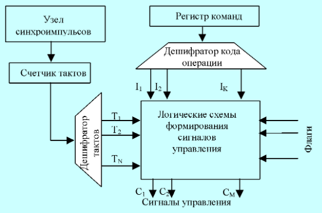

## Микропрограммный автомат с программируемой логикой
- Отличительной особенностью является наличие памяти микропрограмм. 
- Каждой команде соответствует микропрограмма. 
- В современных процессорах отказались от идеи микропрограммирования, так как она стала сдерживать рост производительности.

Схема микропрограммного автомата с программируемой логикой:

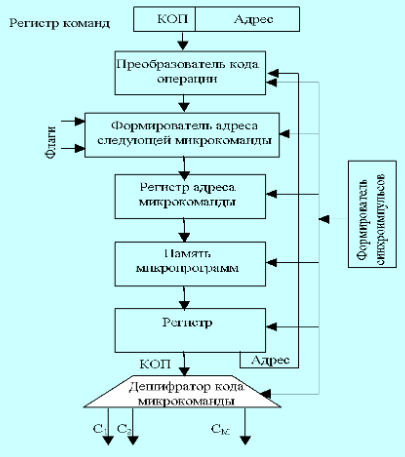

## Команды
Различают следующие виды архитектур системы команд:
- стековую;
- аккумуляторную;
- регистровую;
- с выделенным доступом к памяти.

## Стековая архитектура 
Стек - память, состоящая из взаимосвязанных ячеек, взаимодействующих по принпипу “последним вошел, первым вышел”.

Для работы есть операции: 
- рush (проталкивание данных в стек)
- рор (выталкивание данныx из стека). 

Запись возможна только в верхнюю ячейку стека.

Механизм стеков снижает издержки на адресацию.
При стековой организации все данные идентифицируются вершиной стека.

При описании вычислений с использованием стека используется обратная польская запись.
Выражение а = а + b + а х с в польской записи: а = а b +  а с х+.

## Аккумуляторная архитектура
Аккумулятор - регистр для хранения результата и одного из операндов арифметической или логической операции в процессоре.

Для выполнения операции в АЛУ производится считывание одного из операндов из памяти в регистр данных. Второй операнд находится в аккумуляторе. Выходы регистра данных и аккумулятора подключаются к соответствующим входам АЛУ. По окончании предписанной операции результат с выхода АЛУ заносится в аккумулятор. 

Для работы есть операции: 
- load х (Загрузка в аккумулятор содержимого ячейки х)
- store х (Запись содержимого аккумулятора в ячейку х).

"+" : короткие команды и простоту декодирования команд. 
"-" : многократные обращения к основной памяти.

## Регистровая архитектура
Регистровая архитектура допускает расположение операндов в одной из двух запоминающих сред: основной памяти или регистрах. 

Выделяют три подвида команд обработки: 
- регистр-регистр; 
- регистр-память; 
- память-память.

"+" : компактность получаемого кода, высокая скорость. 
"-" : требует более длинных инструкций. 

## Архитектура с выделенным доступом к памяти
Обращение к основной памяти возможно только с помощью двух специальных команд: load и store.

- load - информация считывается из ячейки памяти в регистр процессора. 
- store - запись из регистра в память.

Операнды во всех командах обработки могут находиться только в регистрах процессора. Результат операции также заносится в регистр.

В архитектуре отсутствуют команды обработки, допускающие прямое обращение к основной памяти. 

АСК с выделенным доступом к памяти  характерна для всех вычислительных машин с RISC-архитектурой. Команды в таких ЭВМ, как правило, имеют длину 32 бита и трехадресный формат.

## Конфигурируемые процессоры Xtensa фирмы Tensilica
Средство разработки Xenergy компании Tensilica является инструментом САПР, которое позволяет оценить влияние конфигураций процессора на потребление энергии. Xenergy позволяет построить более эффективную с точки зрения потребляемой энергии конфигурацию подсистемы «процессор–память». 

Разработчик может модифицировать конфигурацию процессора, добавить расширения команд, регистровые файлы или специализированные программные модули, а также оптимизировать прикладной код с целью снижения общей мощности, потребляемой процессором и памятью.

## Конвейер. Организация памяти. Сегментация
**Конвейер**
Устройство обработки (УО) и устройство управления считыванием/хранением (УСШ) работают параллельно.

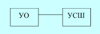

Пока одна операция (К1) находится на этапе выполнения в УО, следующая операция (К2) уже может считываться или записываться через УСШ. Это позволяет не простаивать оборудованию и увеличивает общую производительность.

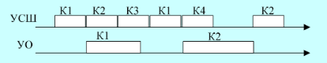

**Сегментация памяти**
Это механизм адресации, используемый в процессорах x86.

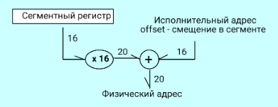

Hазные сегментные регистры (cs, ds, ss, es) указывают на разные участки памяти (код, данные, стек, дополнительные данные). Это позволяет программе обращаться к разным типам информации, просто меняя базовый адрес.

Регистры:
- cs — сегмент кода.
- ds — сегмент данных.
- ss — сегмент стека.
- es — дополнительный сегмент.

ds:bx означает, что физический адрес берется из сегмента данных (ds) со смещением в регистре bx

Для операций с адресами используются команды:
- lea bx, iA — берет адрес переменной iA и кладет в регистр BX
- les bx, pA — берет из памяти pA адрес (в BX) и номер сегмента (в ES). Нужно, чтобы обратиться к памяти за пределами текущего 64-килобайтного куска.

Модели памяти - это настройки компилятора, которые говорили, сколько сегментов (кусков по 64 КБ) может занимать программа:
- Tiny/Small — в одном-двух сегментах.
- Medium/Compact — код или данные разрастается на несколько сегментов.
- Large/Huge — и код, и данные могут быть огромными (много сегментов).

## Форматы команд
1. КОП | w | reg | Данные | Данные 16 — Операнд в регистр
2. КОП | s | w | Постбайт 0 | Данные | Данные 16
3. КОП | d | w | Постбайт | Смещение | Смещен.16
4. КОП | w | Мл. байт адр. | Ст. байт адр. — Кор. орм. прям. адр-ация
5. КОП | v | w | Постбайт — Сдвиги
6. КОП | Условие | Смещение — Условие перехода
7. КОП — Неявн. адрес и управл.
8. КОП | Порт — Ввод-вывод из порта

## Особенности команд процессора i8086 
Семейство процессоров х86 принято относить к классу процессоров CISC (Complicated Instruction Set Computer – с усложненным набором команд).

- Базовая структура основных команд обработки – двухоперандная, один из операндов всегда располагается в регистре процессора, второй может находиться в регистре либо в памяти, причем операнд-приемник может быть как в регистре, так и в памяти.
- Длина команды может лежать в пределах от 1 до 15 байтов
- Форматы кодирования усложнены, в них исключений не меньше, чем правил
- Используются сложные многокомпонентные способы адресации.
- Структуру регистровой модели, набора команд и способов адресации нельзя назвать вполне ортогональной: многие команды, регистры в сильной степени специализированы.
- Команды пересылки не изменяют содержимого признаков.
