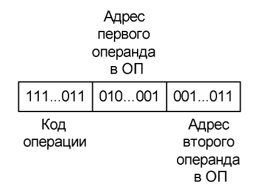

# Рабочий цикл процессора и взаимодействие процессора с оперативной памятью

## Основные положения

- Компьютер в каждый момент времени выполняет определённую программу.
- Программа — последовательность действий (команд), направленная на преобразование входных данных в результат.
- Команды и данные текущей программы хранятся в оперативной памяти (ОП).
- Выполнение команд осуществляет процессор.

## Представление данных

- Данные и команды представляются в ЭВМ в двоичном виде:
  - числа — в двоичной системе счисления, в том числе в форматах со знаком с фиксированной и плавающей точкой;
  - символы — двоичными кодами;
  - двоичные векторы — последовательностями битов.

## Представление команд

Команда — приказ компьютеру на выполнение определённой операции, например сложения двух чисел (операндов), находящихся в оперативной памяти.

Можно представить команду в следующем формате:



Результат, как правило, помещается в память на место первого операнда

Процессор выполняет определённый набор команд — систему команд процессора. В неё входят:
- арифметические и логические команды;
- команды пересылки информации между регистрами процессора и ОП;
- команды передачи управления;
- команды ввода-вывода и др.

Система команд конкретного процессора описывается в соответствующих справочниках.

## Аппаратное обеспечение

Основные элементы рассматриваемой структуры:

**Регистры процессора:**
- РК — регистр команд;
- ПортА — порт адреса;
- ПортД — порт данных;
- Р1 — аккумулятор АЛУ;
- Р2 — второй регистр АЛУ;
- СчАК — счётчик адреса команды.

**Регистры оперативной памяти**
- РАОП — регистр адреса ОП;
- РСОП — регистр слова ОП.

**Другие элементы**
- АЛУ — арифметико-логическое устройство;
- оперативная память;
- шина адреса;
- шина данных;
- шина управления;
- УУиС — устройство управления и синхронизации;
- генератор синхросерии;
- дешифратор КОП (DC).

**Назначение ключевых устройств**
- УУиС управляет работой остальных устройств.
- СчАК хранит адрес очередной команды, которая должна быть считана из памяти и выполнена.
- РК хранит выбранную из памяти команду на протяжении её выполнения.
- АЛУ имеет два регистра для операндов; один из них — аккумулятор, в котором после операции появляется результат.
- ПортА связан с шиной адреса и регистром адреса ОП.
- ПортД связан с шиной данных и регистром слова ОП.

## Обмен процессора с оперативной памятью

**Чтение из ОП**
Чтобы считать данные:
1. процессор выставляет на шину адреса адрес нужного слова ОП;
2. формируется управляющий сигнал ЧтОП;
3. считанные данные появляются в РСОП;
4. данные поступают по шине данных в порт данных.

**Запись в ОП**
Чтобы записать данные:
1. на шину адреса выставляется адрес слова ОП;
2. на шину данных выставляются сами данные;
3. формируется управляющий сигнал ЗпОП.

## 5. Рабочий цикл процессора

**Этап 1. Выборка команды из ОП**

Последовательность:
1. ПортА := СчАК — адрес очередной команды передаётся на шину адреса;
2. ЧтОП — выполняется чтение из ОП;
3. РК := ПортД — считанная команда загружается в регистр команд.

Таким образом, СчАК указывает, откуда нужно получить следующую команду, а РК хранит выбранную команду во время её выполнения.

**Этап 2. Выборка операндов**

Первый операнд:
1. ПортА := A1 — из РК берётся адрес первого операнда;
2. ЧтОП;
3. Р1 := ПортД — первый операнд загружается в аккумулятор.

Второй операнд:
1. ПортА := A2 — из РК берётся адрес второго операнда;
2. ЧтОП;
3. Р2 := ПортД — второй операнд загружается во второй регистр АЛУ.

**Этап 3. Выполнение операции в АЛУ**

Значение поля КОП в РК расшифровывается дешифратором DC.

На соответствующем выходе дешифратора формируется осведомительный сигнал. УУиС по этому сигналу формирует управляющий сигнал для АЛУ, который инициирует микропрограмму требуемой операции.

АЛУ выполняет операцию и помещает результат в Р1 (аккумулятор).

Процессор ожидает завершения работы АЛУ. Сигнал ZАЛУ показывает состояние:
- `1` — АЛУ занято;
- `0` — АЛУ свободно, операция завершена.

**Этап 4. Запись результата в ОП**

После завершения операции:
1. ПортД := Р1 — результат передаётся на шину данных;
2. ПортА := A1 — выставляется адрес первого операнда;
3. ЗпОП — результат записывается в ОП на место первого операнда.

То есть результат, как правило, помещается на место первого операнда.

**Этап 5. Продвижение СчАК**

После выполнения арифметической или логической команды:

СчАК := СчАК + L

где L — длина выполненной команды в байтах.

После этого СчАК указывает на следующую команду.

## Пример с параметрами процессора

В презентации рассматривается пример, где:
- система команд содержит 256 команд, поэтому поле КОП имеет 8 бит;
- в арифметической операции участвуют два операнда из ОП;
- команда содержит два поля адресов операндов;
- ОП организована как последовательность байтов, каждый байт имеет адрес;
- ширина шины данных — 32 бита, поэтому за одну операцию чтения/записи можно передать от 1 до 4 байтов;
- ширина шины адреса — 8 бит, поэтому объём ОП не превышает 2 в 8 = 256 байтов;
- команды и данные хранятся в одной ОП — это принстонская (фон-неймановская) архитектура.

СчАК также часто обозначают как СК (счётчик команд) или PC (Program Counter).

Для команды сложения последовательность выглядит так:
1. СК → шина адреса;
2. команда считывается из ОП → РК;
3. адрес первого операнда из РК → шина адреса;
4. первый операнд → Р1;
5. адрес второго операнда из РК → шина адреса;
6. второй операнд → Р2;
7. АЛУ выполняет сложение → результат в Р1;
8. адрес первого операнда → шина адреса;
9. результат → ОП на место первого операнда;
10. СК увеличивается на длину команды;
11. начинается выполнение следующей команды.

## Признаки результата и флаги АЛУ

АЛУ формирует не только результат, но и признаки результата.

Для арифметических и некоторых логических операций:
- `ШАЛУ(0) = 1` — результат равен нулю;
- `ШАЛУ(1) = 1` — результат меньше нуля;
- `ШАЛУ(2) = 1` — результат больше нуля;
- `ШАЛУ(3) = 1` — произошло переполнение с фиксированной точкой.

Четырёхразрядный унитарный код преобразуется шифратором в двухразрядный позиционный код:
- `00` — результат равен нулю;
- `01` — результат меньше нуля;
- `10` — результат больше нуля;
- `11` — переполнение с фиксированной точкой.

Дополнительные флаги:
- `ШАЛУ(4) = 1` — переполнение порядка;
- `ШАЛУ(5) = 1` — исчезновение порядка;
- `ШАЛУ(6) = 1` — потеря значимости;
- `ШАЛУ(8) = 1` — деление на ноль.

**Регистры для признаков и исключений**
- РПР — регистр признака результата;
- РФ — регистр флагов прерываний.

В РПР сохраняется признак результата для операций `add`, `sub`, `inc`, `dec`, `and`, `or`, `xor`.

Флаги исключительных ситуаций сохраняются в РФ для последующего анализа системой прерываний.

## Команды передачи управления

Обычное выполнение команд идёт последовательно: после команды СчАК увеличивается на длину текущей команды.

Для перехода к произвольной команде используются команды перехода (передачи управления).

Пример — условный переход по маске.

Формат команды:
- КОП — код операции;
- M — маска;
- A — адрес перехода.

Правила:
- если в M или A стоят нули, переход не выполняется;
- если M состоит из одних единиц, переход выполняется обязательно;
- если признак результата соответствует коду, заданному маской M, адрес в СчАК заменяется адресом перехода A;
- иначе выполнение продолжается по обычной последовательности;
- признак результата при этом не изменяется.

Разрядность адресного поля и СчАК определяется разрядностью адреса в вычислительной системе, которая зависит от объёма ОП.

## Прерывания

Во время выполнения программы могут возникать события, требующие перехода к специальной программе обработки.

**Исключения**
Исключения возникают из-за ситуаций, связанных с выполнением команды, например:
- деление на ноль;
- переполнение с фиксированной точкой;
- переполнение порядка;
- исчезновение порядка;
- потеря значимости.

Такие прерывания, как правило, не могут быть замаскированы.

**Прерывания от внешних устройств**
Могут возникать при запросах внешних устройств на ввод-вывод. Например, нажатие клавиши клавиатуры может вызвать обработку соответствующего прерывания.

Прерывания от внешних устройств могут быть замаскированы.

**Мультипрограммный режим**
Современные компьютеры работают в мультипрограммном режиме:
- каждой программе выделяется квант времени;
- после его окончания таймер вызывает прерывание;
- процессор переключается на другую программу;
- после обработки прерывания выполнение возвращается к тому месту прерванной программы, где оно было остановлено.

## Аппаратная поддержка системы прерываний

Для поддержки прерываний используются:
- РФ — регистр флагов прерываний;
- РМ — регистр масок прерываний;
- УС — указатель стека.

В РФ каждому источнику/причине прерывания соответствует свой бит.

В РМ можно установить соответствующий бит, чтобы замаскировать определённое прерывание. При этом существуют немаскируемые прерывания.

**Таблица векторов прерываний**

В начале ОП (для гарвардской архитектуры — в памяти программ) выделяется область под таблицу векторов прерываний (ТВП).

Каждой причине прерывания соответствует:
- бит в РФ;
- слово в ТВП;
- адрес программы обработки прерывания.

В соответствующем слове ТВП находится команда безусловного перехода на первую команду программы обработки этого прерывания.

**Стек**

Для сохранения адреса возврата используется стек.

Стек реализует принцип LIFO (Last In, First Out).

УС хранит адрес верхушки стека (верхнего свободного элемента).

## Последовательность обработки прерывания

После выполнения очередной команды процессор анализирует РФ.

Если обнаружен установленный бит `Fi = 1`, выполняются следующие действия:

1. В стек записывается значение СК — адрес следующей ещё не выполненной команды.
2. УС увеличивается на 1.
3. В СК загружается адрес соответствующего слова ТВП.
4. Выполняется команда безусловного перехода `JMP Ai`.
5. Процессор выполняет программу обработки прерывания.
6. Последняя команда обработчика — **RETI (Return Interrupt)**.
7. При RETI из стека извлекается сохранённый адрес возврата и загружается в СК.
8. Процессор продолжает выполнение прерванной программы.

Упрощённо:

```text
ОП[УС] = СК
УС = УС + 1
СК = i
JMP Ai
...
RETI:
    УС = УС - 1
    СК = ОП[УС]
```

Если одновременно обнаружено несколько прерываний, выполняется процедура их опроса с учётом или без учёта приоритетов.

## Важное ограничение векторной системы прерываний

В системе с описанным механизмом в стек сохраняется только адрес возврата.

Если обработчик прерывания изменяет содержимое регистров, необходимых для продолжения прерванной программы, программист должен самостоятельно сохранить их значения и восстановить перед RETI.

В некоторых системах аппаратно сохраняются и восстанавливаются не только адрес возврата, но и значения ряда специальных регистров. Они могут объединяться в слово состояния программы (ССП или PSW).
