# 10 задач для отработки BIOS/UEFI в Lenovo BIOS Simulator Center

Симулятор: [ссылка](https://download.lenovo.com/bsco/index.html)

## Задача 1. Навигация по основным разделам
**Задание:** Последовательно откройте разделы Main, Config, Security, Startup, Restart. Выпишите, какая информация отображается в Main (серийный номер, версия UEFI, тип CPU).

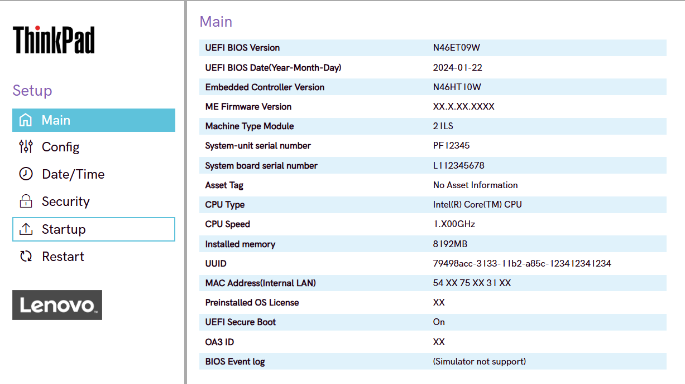

Разделы можно найти справа, переключаясь по ним мы можем переходит по разным вкладкам.

### Информация с Main

| Параметр | Значение |
| :--- | :--- |
| **UEFI BIOS Version** | N46ET09W |
| **UEFI BIOS Date (Year-Month-Day)** | 2024-01-22 |
| **Embedded Controller Version** | N46HT10W |
| **ME Firmware Version** | XX.X.XX.XXXX |
| **Machine Type Module** | 21LS |
| **System-unit serial number** | PF12345 |
| **System board serial number** | L1I2345678 |
| **Asset Tag** | No Asset Information |
| **CPU Type** | Intel(R) Core(TM) CPU |
| **CPU Speed** | 1.X00GHz |
| **Installed memory** | 8192MB |
| **UUID** | 79498acc-3133-11b2-a85c-123412341234 |
| **MAC Address(Internal LAN)** | 54 XX 75 XX 31 XX |
| **Preinstalled OS License** | XX |
| **UEFI Secure Boot** | On |
| **OA3 ID** | XX |
| **BIOS Event log** | (Simulator not support) |

## Задача 2. Смена порядка загрузки
**Задание:** Перейдите в Startup → Boot. Сделайте USB первым, NVMe — вторым. Запомните клавишу сохранения (F10).

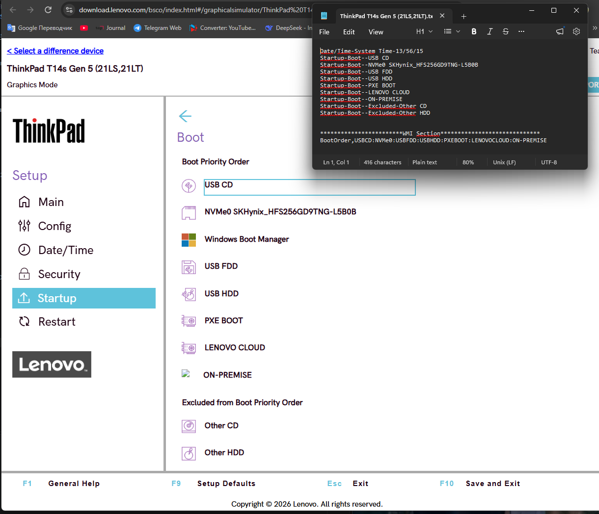

На скриншоте видно измененный порядок загрузки, а такде открыт файл формата txt. Он скачался автоматически после нажатия кнопки сохранения F10.

## Задача 3. Включение/выключение Secure Boot
**Задание:** Перейдите в Security → Secure Boot. Проверьте статус, переключите на противоположный, верните обратно. Отметьте, требуется ли перезагрузка.

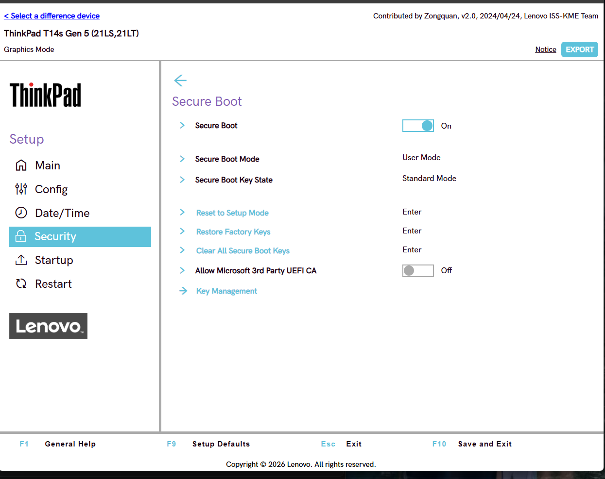

На скриншоте переключатель Secure Boot находиться сверху в положении On. При включении и выключеннии Secure Boot симуляция не потребовала перезагрузки, но в реальности, я предпологаю, что перезагрузка нужна. 

## Задача 4. Установка пароля супервизора
**Задание:** Перейдите в Security → Password → Supervisor Password. Установите пароль `Test1234`. Попробуйте изменить любую настройку — должен появиться запрос пароля. Затем сбросьте пароль.

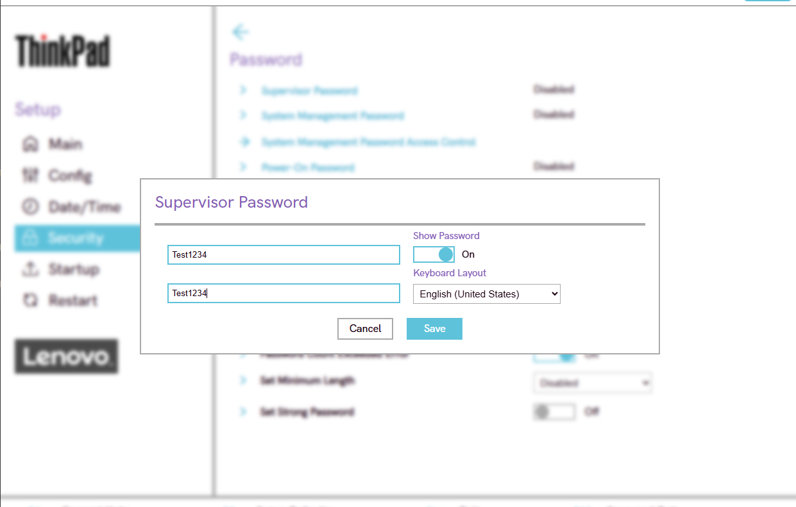

На скриншоте окно установки пароля. Из-за упрощений симуляции при изменении настроек пароль не требовался.

## Задача 5. Сброс на заводские настройки
**Задание:** Перейдите в Restart → Load Factory Defaults (или F9). Подтвердите сброс. Проверьте, что настройки из задач 2–4 сброшены.

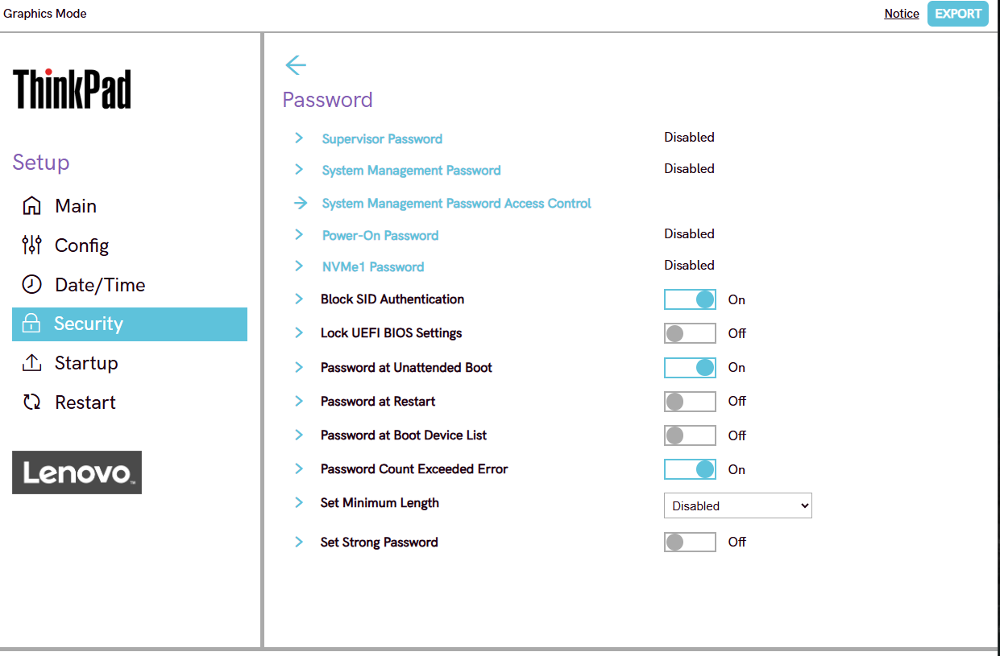

На скриншоте видно, что у нас не стоит никакой пароль. При нажатии на F10 вылезает окно с сообщением, что мы ничего не поменяли. 

## Задача 6. Управление встроенными устройствами
**Задание:** Перейдите в Config → USB. Найдите USB BIOS Support или Always On USB. Отключите, затем включите обратно. Запишите точный путь.

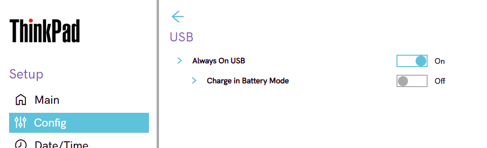

На скриншоте открытка вкладка о USB. После переключения Always On USB и включения симуляция ничего не потребовала. 

**Путь до Always On USB:** `Config → USB → Always On USB`

## Задача 7. Режим работы SATA/NVMe
**Задание:** Перейдите в Config → Storage → SATA Controller Mode (или NVMe Mode). Посмотрите варианты (AHCI / RAID / Intel RST), переключите и верните обратно. Обратите внимание на предупреждения.

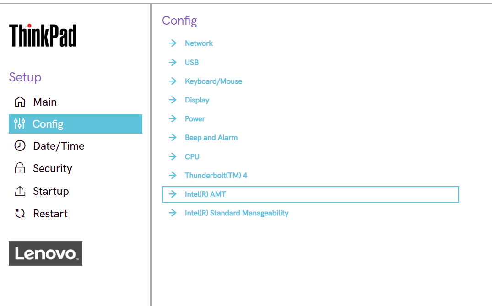

На скриншоте открыта вкладка Config. На ней мы не можем найти Storage, это вновь скорее всего связанно с ограничениями симуляции. На обоих варинатах устройств (ThinkPad T14s Gen 5, ThinkPad X1 Carbon Gen 12) нет Storage в Config. 

Из-за этого задание не может быть сделанно полностью.

## Задача 8. Временное меню загрузки (эмуляция F12)
**Задание:** Найдите опцию Startup → Boot Mode или эмуляцию F12 Boot Menu. Активируйте, затем вернитесь в главное меню.

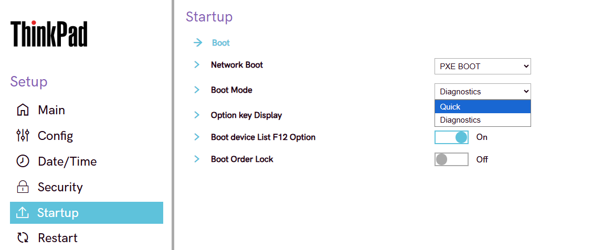

На скриншоте опция Boot Mode дает нам выбрать 2 варианта. По умолчанию стоит вариант `Quick`. Он был поменян на `Diagnostics`.

## Задача 9. Просмотр системных логов
**Задание:** Перейдите в Main → System Summary (или Config → Diagnostics). Найдите раздел с логами POST/событий. Просмотрите их, найдите Clear Event Log (если есть) и очистите.

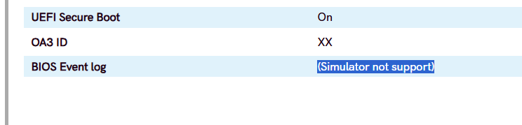

На скриншоте можно увидеть, что система логирования не реализована в этой симуляции. Так как симулятор не поддерживает просмотр логов, открыть и очистить их не удалось.

**Точный путь до логов:** `Main → BIOS Event log`

## Задача 10. Полный сценарий: подготовка к переустановке ОС
**Задание:** 
1. Сбросить настройки на Factory Defaults (1 мин).
2. Включить Secure Boot (1 мин).
3. Установить Supervisor Password (2 мин).
4. Поставить USB первым в порядке загрузки (2 мин).
5. Сохранить и выйти (F10) (1 мин).
6. Снова войти, проверить настройки, сбросить пароль и вернуть порядок загрузки (2 мин).

### Выполнение по пунктам

#### 1. Сбросить настройки на Factory Defaults

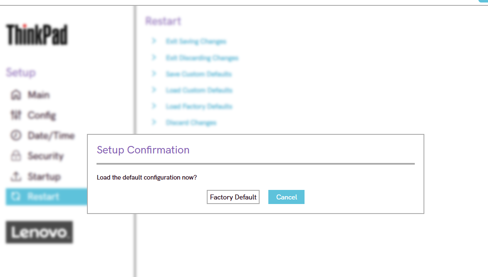

На скриншоте окно потверждегния сброса системы до заводских настроек. 

#### 2. Включить Secure Boot

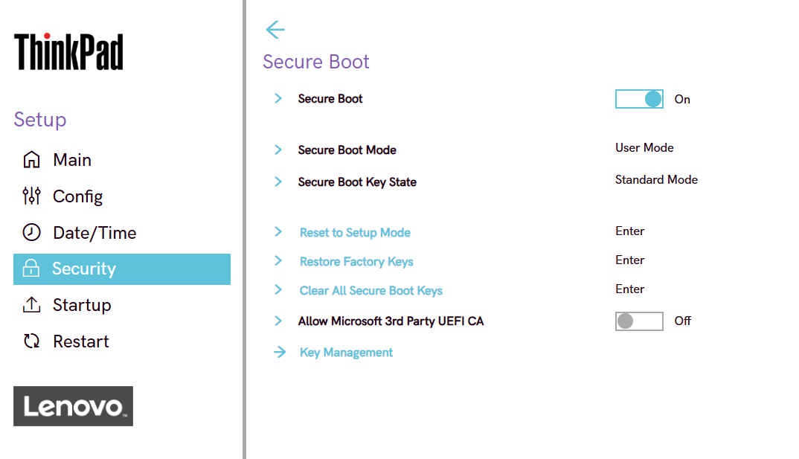

На скриншоте окно Secure Boot с включенной опцией для Secure Boot.

#### 3. Установить Supervisor Password

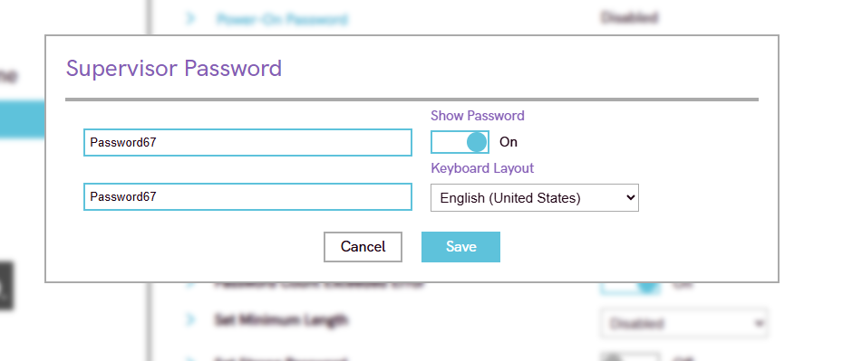

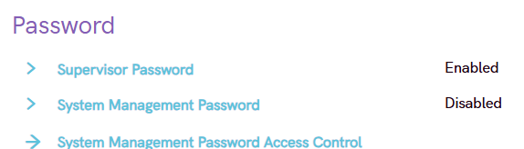

На сриншотах окно установки пароля, и вкладка Password с включенным Supervisor Password.

#### 4. Поставить USB первым в порядке загрузки

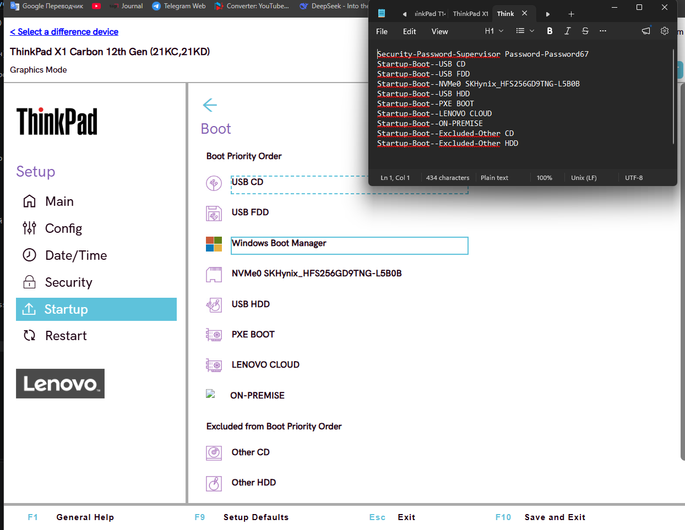

На скриншоте измнене порядок загрузки. 

#### 5. Сохранить и выйти (F10)

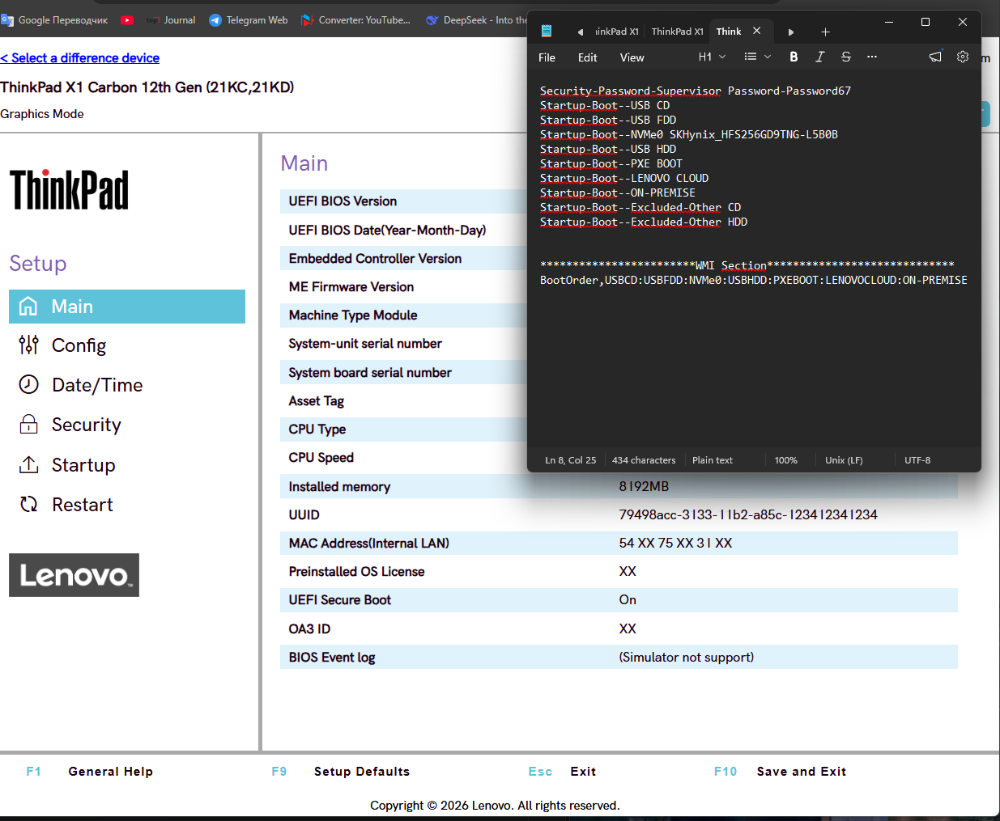

На сохранненые данные в файле открытом. При нажатии Esc (Выход) настройки сохранились. 

#### 6. Снова войти, проверить настройки, сбросить пароль и вернуть порядок загрузки

На